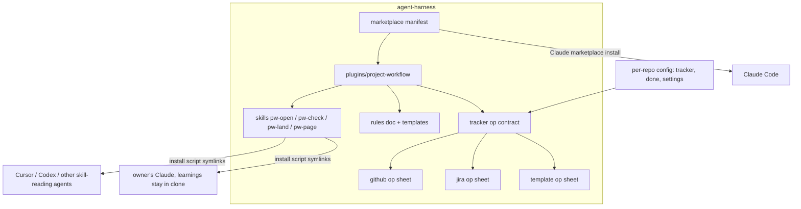
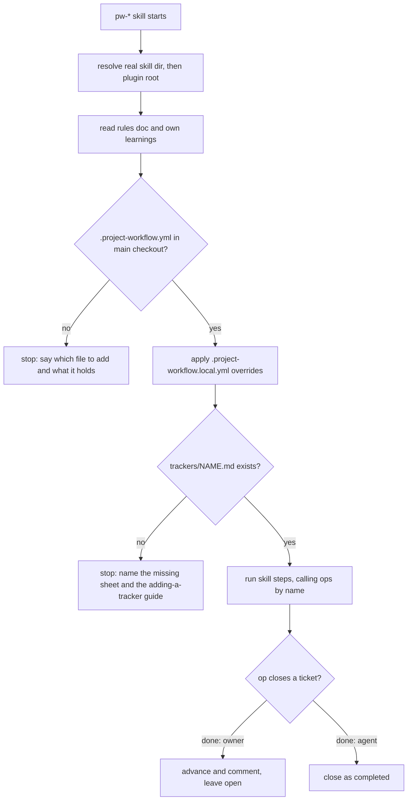

# Portable Project Workflow Plugin - Plan

## Goal Capsule

- **Objective:** The repo owner, and anyone who installs the repo, can run the multi-thread project workflow (open, check, land, page) on their own repos with GitHub or Jira as the tracker. It works from any agent that reads Agent Skills, and carries no tie to a particular employer or tracker site.
- **Means:** A new public repo `agent-harness` at `~/workplace-personal/agent-harness`, holding opt-in plugins. `plugins/project-workflow` is the first, generalized from the work-only project-workflow plugin.
- **Product authority:** The repo owner. Other plugins that may later join the repo are not active scope.
- **Authority:** The Product Contract's R-IDs decide product behavior, the KTDs decide mechanism, and a unit overrides neither.
- **Execution profile:** One change set in `agent-harness`, landed as local commits because the repo has no remote. U8 adds one config file to `stoep` on its own branch, committed and not pushed.
- **Stop conditions:** Stop when a session-settled decision cannot work as written, or when a `stoep` thread turns out to be live (U8).
- **Who finishes:** The owner creates the GitHub remote, publishes, picks a license, installs the skills on their machine, and scopes the employer's plugin away from personal repos.
- **Open blockers:** None. The repo exists locally (`git init`, no commits, no remote).
- **Product Contract preservation:** changed: one Dependencies assumption corrected (`~/.agents/skills/` does not exist on the owner's machine). Requirements, Key Decisions, and Acceptance Examples are unchanged.

---

## Product Contract

### Summary

A public `agent-harness` repo with `plugins/project-workflow`, a de-employer'd copy of the project-workflow rules, templates, and `pw-open` / `pw-check` / `pw-land` / `pw-page` skills. They are written as portable Agent Skills and reach the tracker only through pluggable markdown op sheets: GitHub and Jira ship in v1, and a template makes adding another one routine.

### Problem Frame

The project workflow exists only as a plugin in an employer's harness. That plugin hard-codes one Jira site and cloudId, names employer-specific MCP tools, delivers its rules through a Claude-only SessionStart hook, and archives to a work path. Personal repos cannot use it as is. The one personal project run so far (`stoep`, `scratch/GH-3-foundation/`) states in its tracker header that open, check, and land "are done by hand, following `/pw-open`, `/pw-check` and `/pw-land` with `gh` in place of Jira". Every step costs manual translation, and the rules reach that session only because the work plugin is enabled globally.

The owner also expects the first other user may not use Claude, and other users will track work in different systems (GitHub, Jira, Azure DevOps). A Claude-only, Jira-only design would have to be rebuilt for them.

### Key Decisions

- **New public repo `agent-harness` holding opt-in plugins under `plugins/`.** It is a collection, so future skills have a home. (session-settled: user-directed — chosen over a private repo and over a stow package inside dotfiles: others should be able to install it.) Governs R1, R3.
- **Each plugin is a real Claude plugin and a set of portable skill folders at once.** It gets two install paths from one tree, with no fork. (session-settled: user-approved — chosen over a plain `packages/` folder: the Claude plugin layout already contains the Agent Skills layout.) Governs R2.
- **Provider-agnostic stays a v1 requirement.** (session-settled: user-directed — chosen over a Claude-only v1: the first other user may not use Claude.) Governs R5, R6.
- **No always-on rules: skills load the rules when they run.** (session-settled: user-directed — chosen over a per-repo AGENTS.md pointer block and over global per-agent rules files.) Governs R7, R8, R9.
- **Tracker adapters are markdown op sheets.** (session-settled: user-directed — chosen over per-tracker scripts with a uniform CLI, which cannot reach MCP-only trackers, and over a local-first model that mirrors out to the tracker.) Governs R10, R11, R12.
- **Who closes tickets is a per-repo setting, defaulting to the owner.** (session-settled: user-directed — chosen over "always owner" and "always agent".) Governs R14.
- **Recipes stay `/ce-*` with Compound Engineering as a prerequisite.** Neutral stage verbs come later, once other skill sets have been tried against real recipes. (session-settled: user-directed — chosen over neutral verbs plus a per-repo mapping, for now.) Governs R17.
- **Portability is proven structurally in v1.** (session-settled: user-directed — chosen over also requiring a live run in a non-Claude agent: none is installed on the owner's machine.) Governs R6.
- **Skill names stay `pw-open`, `pw-check`, `pw-land`, `pw-page`.** The work plugin gets scoped to work repos rather than the personal skills taking a new prefix. (session-settled: user-directed — chosen over a distinct prefix such as `pj-*`, and over letting both sets overlap.)

### Architecture

One plugin tree feeds both install paths. Skills reach a tracker only through the op contract.



### Requirements

**Repo and packaging**

- R1. The repo `agent-harness` holds opt-in plugins, each under `plugins/<name>/`. `project-workflow` is the first and only plugin in v1.
- R2. Every plugin installs two ways from the same source tree: as a Claude Code plugin through a marketplace manifest at the repo root, and through an install script that symlinks the chosen plugins' skill folders into the skill directories of other agents (and of Claude, for an owner who wants edits to stay in the clone).
- R3. Nothing installs unless the user names it. The repo README is a plugin catalog with install steps per agent, and each plugin's README states its prerequisites.
- R4. The repo contains no employer names, Jira sites, cloudIds, work emails, or other personal values. Anything user-specific comes from per-repo or per-user config.

**Portability**

- R5. Skills use the portable Agent Skills format. Skill bodies name no Claude-only tool, environment variable, or frontmatter field that the skill depends on. A plugin may add Claude-only extras such as hooks, but nothing may depend on them.
- R6. A repo-wide structural test enforces R5 across every plugin and fails with the offending file and line.

**Rules delivery**

- R7. No rules are injected into a session. Each `pw-*` skill reads the plugin's rules doc and its own learnings file at the start of a run.
- R8. The tracker template's header tells the reader where the rules doc lives. A thread dispatched from a tracker never runs a `pw-*` skill, so this is how it finds the rules.
- R9. When the plugin is installed by symlink, learnings appended during use land in the owner's git clone, not in an install cache.

**Trackers**

- R10. Skills reach a tracker only through a fixed op contract: key format, read root, read ticket, list children, cut or reparent a child, comment, advance status, close, cancel as won't-do, and a status map onto the workflow's status chips. Skill bodies never name a tracker-specific tool or command.
- R11. Each tracker is one markdown op sheet that implements every op with concrete CLI or MCP steps. v1 ships GitHub (the `gh` CLI, issues and sub-issues, root keys `GH-<n>` with the repo taken from config) and Jira (site and project from config).
- R12. A template op sheet and a short guide make adding a tracker a matter of copying the template, filling in each op, and naming it in config, with no skill edits. The guide uses Linear as its worked example and names Azure DevOps as the next adapter.
- R13. Each repo opts in by declaring its tracker and that tracker's settings in a repo-level config file. A `pw-*` skill run in a repo without the file stops and says how to opt in.
- R14. Each repo config carries `done: owner | agent`, defaulting to `owner`. With `owner`, agents never close a ticket or move it to Done, and PR bodies reference tickets without closing keywords. With `agent`, PR bodies may use closing keywords and `/pw-land` may close the ticket or move it to Done.
- R15. An obsolete ticket is always cancelled through the op sheet's won't-do mapping (GitHub "not planned", Jira Won't Do), never closed as done.

**Workflow parity**

- R16. The rules doc, the tracker / decomposition / ladder templates, and the four skills keep the source plugin's behavior: the project folder map, one home per fact, status chips, routing, the dispatch formula, Messages, live-thread safety, landing, and closing with archive. Jira-specific wording becomes tracker-neutral ("root", "ticket", "tracker").
- R17. Thread recipes stay `/ce-*` commands, and Compound Engineering is a stated prerequisite of `project-workflow`.
- R18. The project archive location comes from config, defaulting to a `project-archive/<repo>/` folder beside the user's repos, never a fixed work path.

### Acceptance Examples

- AE1. **Covers R10, R11, R16.** **Given** stoep's `scratch/GH-3-foundation/` and a stoep config naming the GitHub tracker, **when** the owner runs `/pw-check` on it, **then** the board renders and reconciles against `StefanNiehaus/stoep` issues through the GitHub op sheet, with no hand-substituted `gh` steps.
- AE2. **Covers R13.** **Given** a repo with no project-workflow config, **when** `/pw-open` runs, **then** it writes nothing and tells the user which config file to add and what it must contain.
- AE3. **Covers R14.** **Given** `done: owner`, **when** `/pw-land` lands a deliverable whose PR merged, **then** the ticket is advanced and commented but stays open, and the PR body read "Refs #12". **Given** `done: agent`, the same land closes the ticket as completed.
- AE4. **Covers R6.** **Given** a skill body that names an `mcp__…` tool or `${CLAUDE_PLUGIN_ROOT}`, **when** the structural test runs, **then** it fails and names the file and line.
- AE5. **Covers R12.** **Given** a new op sheet copied from the template and filled in for Linear, **when** a repo's config names `linear`, **then** `/pw-open` and `/pw-check` use it without any skill file changing. This is shown by the guide's walkthrough, not by shipping a Linear sheet.

### Success Criteria

- The stoep `GH-3-foundation` project runs on the new plugin: its tracker header points at the new rules doc instead of "done by hand", and AE1 holds.
- A search of the repo for the employer name, its Jira site, and the work email returns nothing.

### Scope Boundaries

**Deferred for later**

- An Azure DevOps op sheet, and any Linear op sheet beyond the guide's worked example.
- Neutral stage verbs with a per-repo recipe mapping, which waits until skills beyond Compound Engineering have been tried.
- A live end-to-end run from a non-Claude agent.
- Always-on rules delivery (a hook or an AGENTS.md block) as an optional Claude extra.
- Plugins other than `project-workflow`.

**Outside this work**

- Changes to the employer's project-workflow plugin or its repo, and any move to converge that plugin onto this one.
- Creating the GitHub remote and publishing the repo, which stay with the owner.

### Dependencies / Assumptions

- Compound Engineering is installed wherever the workflow is used (R17).
- GitHub sub-issues are available on the owner's repos for the children op. If they are not, the GitHub sheet falls back to a task-list or label convention, which is for planning to choose.
- On the owner's machine, the employer's project-workflow plugin is still enabled user-globally (`~/.claude/settings.json`). Until it is scoped to work repos, its hook injects employer rules into personal Claude sessions and its `pw-*` skills show beside the personal ones. Scoping it is an owner machine step, not repo content.
- `~/.agents/skills/` is the cross-agent skill directory: Codex and Gemini CLI both document reading it. It does not exist on the owner's machine yet, so the install script creates it.

### Outstanding Questions

**Deferred, for the owner**

- Which license the public repo carries. It gates publishing, not this work, and no `LICENSE` file is added until the owner picks one.

### Sources / Research

- Source plugin (another repo, the employer harness): `plugins/project-workflow/` with `docs/project-workflow.md` (rules, 99 lines), `templates/` (tracker, decomposition, ladder), `skills/pw-{open,check,land,page}/` (SKILL.md and learnings.md), and `hooks/` (SessionStart rules injection, UserPromptSubmit learnings injection, SubagentStart tracker pointer). Its `CLAUDE.md` documents the hook delivery boundary and the 100-line rules cap.
- Jira coupling in the source: `skills/pw-open/SKILL.md` names a fixed cloudId and an employer-prefixed Atlassian MCP tool in `allowed-tools`. `pw-check` learnings record Jira pagination and child-discovery lessons (`parent = <root>` queries) that the Jira op sheet should carry.
- Dogfood project: `~/workplace-personal/stoep/scratch/GH-3-foundation/tracker.md`. Its header records GitHub tracking with `gh` and a personal-account token, and hand-run open, check and land.
- The owner's harness memory notes that a plugin-cache update drops cache-local learnings lines, which is the reason for R9.

---

## Planning Contract

**Target repo:** `agent-harness` (`~/workplace-personal/agent-harness`). Paths below are relative to it unless a unit names `stoep`.

### Key Technical Decisions

- KTD1. **A skill finds its plugin from the real path of its own folder.** Each skill's first step resolves the physical path of its skill directory, then reads `../../docs/project-workflow.md`, `../../templates/`, and `../../trackers/` from there. A symlinked skill folder points into the clone, so the same two-levels-up walk holds under both install paths. Resolving first matters because some file tools collapse `..` textually and would land beside the symlink instead of inside the clone. Governs R2, R7.
- KTD2. **Per-repo config is `.project-workflow.yml` at the root of the main checkout.** It is committed, flat YAML that an agent reads without a parser: `tracker`, `done`, optional `archive_root`, and one block named after the tracker (`github: repo, account` or `jira: site, project, land_status`). An optional gitignored `.project-workflow.local.yml` beside it overrides any key for one user. Credentials never go in either file: they come from the tracker CLI's own login or from environment variables the op sheet names. Governs R4, R13, R14, R18.
- KTD3. **`bin/install` only symlinks, and only what it is told.** `bin/install <plugin> [--agent <name>]… [--dir <path>]` links each `plugins/<plugin>/skills/*` folder into the target skill directory. With no target it uses `~/.agents/skills/`. Named agents map to `claude` → `~/.claude/skills/`, `codex` and `gemini` → `~/.agents/skills/`, `cursor` → `~/.cursor/skills/`. It never replaces a real folder or a link that points somewhere else, and it reports each such conflict. `--uninstall` removes only links that point into this clone. Run with no plugin, it lists the plugins and installs nothing. Governs R2, R3, R9.
- KTD4. **On Claude, marketplace install and symlink install are alternatives.** Installing both gives two copies of every skill (`/pw-open` and `/project-workflow:pw-open`). The READMEs say to pick one and recommend the symlink install to anyone who wants appended learnings kept, because a marketplace cache update discards them. Governs R2, R9.
- KTD5. **Skill frontmatter is `name` and `description` only.** The open spec also allows `license`, `compatibility`, `metadata`, and `allowed-tools`, and the structural test accepts those, but the skills drop `allowed-tools` because its values are one agent's tool names. `user-invocable` goes too: it is a Claude extension and other skill loaders reject unknown keys. Governs R5.
- KTD6. **GitHub status is the issue's open or closed state plus two labels.** `pw:in-progress` marks started work and `pw:ready-to-close` marks landed work that waits for its owner under `done: owner`. The sheet creates a label the first time it needs it. A Projects field was rejected because it needs a board per repo and an extra token scope. Comments alone were rejected because one list call cannot read them back as status. Governs R11, R14.
- KTD7. **The GitHub sheet uses `gh`'s native sub-issue support.** `gh issue create --parent`, `gh issue edit --parent` / `--remove-parent`, and the `subIssues` and `parent` JSON fields cover cut, reparent, and list-children (verified on gh 2.97.0). The sheet states the minimum `gh` version and gives the `gh api` sub-issue endpoints for an older one. No task-list or label fallback is built. Governs R11.
- KTD8. **The Jira sheet maps status by Jira's status category, not by status name.** To Do, In Progress, and Done categories exist on every site, so the chip map holds without site-specific names. `advance-status` reads the available transitions before each hop, because transition ids depend on the current status. Under `done: owner` the agent walks to `jira.land_status` when the config names one. Otherwise it leaves the status alone, adds the label `pw-ready-to-close`, and comments "ready to close", and the status map reads that label as landed. Governs R11, R14, R15.
- KTD9. **Each Jira op gives two routes: an Atlassian MCP when the session has one, else REST.** The MCP route names the generic Atlassian operations (get issue, JQL search, transitions, edit, create) and looks the cloud id up from `jira.site`. The REST route uses `curl` against `https://<site>/rest/api/3` with `JIRA_EMAIL` and `JIRA_API_TOKEN` from the environment. An Atlassian CLI was rejected as a third dependency that neither the owner nor the dogfood needs. Governs R11.
- KTD10. **The tracker header carries the rules doc's absolute path, and `/pw-check` keeps it true.** `/pw-open` writes the resolved path into the header. A marketplace cache path changes on plugin update, so `/pw-check` reports a header path that no longer exists as drift and `sweep` rewrites it. Governs R8.
- KTD11. **The ops are fixed names that every sheet uses as headings.** `key-format`, `read-root`, `read-ticket`, `list-children`, `cut`, `reparent`, `comment`, `advance-status`, `close`, `cancel`, `status-map`. `cut` takes an optional parent and a type, so it also creates a standalone ticket at project close. `reparent` accepts "none", which is how a kept ticket is made to stand alone. `key-format` also says how a PR body references a ticket with and without a closing keyword. Governs R10, R12, R14.
- KTD12. **Tests are plain bash with no test framework.** `tests/run` executes every `tests/*.test.sh`. The structural test takes a root directory argument, so it proves each failure case by running against a small broken fixture tree. Neither `bats` nor `shellcheck` is installed on the owner's machine, and the source plugin tests the same way. Governs R6.
- KTD13. **The employer-name search runs from a list kept outside the repo.** The repo cannot hold the strings it bans. The structural test always checks generic shapes (a cloud-id UUID next to "cloudId", an `atlassian.net` host other than `example.atlassian.net`, an email address outside `example.com` and `noreply` hosts) and additionally reads patterns from a gitignored `.denylist.local` or the file named by `PW_DENYLIST_FILE`. Governs R4.
- KTD14. **No hooks ship in v1.** The source's three hooks all exist to inject rules or learnings, which R7 replaces with a read at the start of each skill. The rules doc keeps the discipline line that tells an agent to name the tracker path and the rules doc path when it hands a subagent project work. Governs R5, R7.

### High-Level Technical Design

How one skill run reaches a tracker:



Status map each sheet must fill:

| Chip | Meaning | GitHub | Jira |
|---|---|---|---|
| ⬜ | not started | open, no `pw:` label | To Do category |
| 🟡 | in progress or in review | open, `pw:in-progress` | In Progress category |
| 🟢 | done | closed as completed, or open with `pw:ready-to-close` | Done category, at `land_status`, or labelled `pw-ready-to-close` |
| ❌ | cancelled | closed as not planned | Done category with a won't-do resolution |
| 🔴 ⚪ | blocked, folded | no mapping | no mapping |

### Output Structure

```text
.claude-plugin/marketplace.json
.github/workflows/ci.yml
.gitignore
AGENTS.md
CLAUDE.md -> AGENTS.md
README.md
bin/install
tests/run
tests/structure.test.sh
tests/install.test.sh
tests/fixtures/
plugins/project-workflow/
  .claude-plugin/plugin.json
  README.md
  docs/project-workflow.md
  docs/config.md
  docs/adding-a-tracker.md
  templates/{tracker,decomposition,ladder}.md
  trackers/{contract,github,jira,_template}.md
  skills/pw-{open,check,land,page}/{SKILL.md,learnings.md}
```

### Assumptions

- The code host is GitHub. The skills keep the source's `gh pr` calls for PR state, because the Product Contract makes only the tracker pluggable.
- Cursor's `~/.cursor/skills/` path comes from search snippets, not a fetched doc page. The install script's agent map is one small table, so a wrong entry is a one-line fix.
- Whether Claude reports a symlinked skill's base directory as the link or the target is undocumented. KTD1 is correct under either.
- The source's 100-line cap on the rules doc existed because the doc cost tokens in every session. With R7 that cost is gone, so the cap test is not carried over.

### Sequencing

U2 comes before the content units so each of U3 to U5 is written against a test that already fails on the banned patterns. U6 and U7 do not depend on content. U8 runs last, against the finished tree.

### Sources

- Source plugin: `plugins/project-workflow/` in the employer harness repo on the owner's machine. Read it there; nothing is imported from it at run time.
- Claude plugin and skill behavior: `code.claude.com/docs/en/plugins/loading.md`, `.../skills.md`. Per-key `enabledPlugins` merge lets a project file turn off a user-enabled plugin. No parent-directory settings scope is documented.
- Frontmatter fields: `agentskills.io/specification`.
- Skill directories: Codex (`learn.chatgpt.com/docs/build-skills.md`) and Gemini CLI (`geminicli.com/docs/cli/skills/`) both read `~/.agents/skills/`.

---

## Implementation Units

### U1. Repo scaffold and manifests

- **Goal:** The repo is a valid Claude marketplace with one plugin entry and a test entry point.
- **Requirements:** R1, R2, R3
- **Dependencies:** none
- **Files:** `.claude-plugin/marketplace.json`, `plugins/project-workflow/.claude-plugin/plugin.json`, `.gitignore`, `AGENTS.md`, `CLAUDE.md` (symlink to `AGENTS.md`), `tests/run`
- **Approach:** The marketplace name is `agent-harness` and the owner field carries the GitHub handle only, with no email. `.gitignore` covers `scratch/`, `.worktrees/`, `.denylist.local`, and `.project-workflow.local.yml`. `AGENTS.md` tells contributors the two rules that the structural test enforces (R4, R5), where an observation goes (a skill's `learnings.md`, the rules doc, or a template), and how to run `tests/run`.
- **Patterns to follow:** the source repo's `.claude-plugin/marketplace.json` and the plugin's `plugin.json`.
- **Test expectation:** none -- scaffolding. U2 asserts the manifests parse and list every plugin directory.
- **Verification:** `tests/run` exists, is executable, and exits zero with no test files yet failing.

### U2. Structural test

- **Goal:** One command fails, with file and line, whenever a plugin breaks portability, tracker neutrality, or the no-personal-values rule.
- **Requirements:** R4, R5, R6, R10, R12
- **Dependencies:** U1
- **Files:** `tests/structure.test.sh`, `tests/fixtures/` (one small tree per failure case, plus one clean tree)
- **Approach:**
  1. The script takes a root directory (default: the repo) and checks every `plugins/*/`.
  2. Frontmatter: only the keys KTD5 allows, and `name` equals the folder name.
  3. Banned in skills, rules doc, templates, and tracker files: `mcp__`, `CLAUDE_PLUGIN_ROOT`, `__PLUGIN_ROOT__`, and other agent-specific tool or hook names.
  4. Banned in skills, rules doc, and templates only: tracker-specific commands and terms (`gh issue`, `gh api`, `jql`, `Jira`, `cloudId`). Tracker sheets are exempt.
  5. Personal values per KTD13, across every tracked text file in the repo (root files, `docs/`, `.github/`, `tests/`), not only `plugins/`. Fixture files that exist to trip this check are the one exemption.
  6. Every op named in `trackers/contract.md` appears as a heading in every other file under `trackers/`.
  7. Every relative path a `SKILL.md` cites resolves inside its plugin.
  8. Skill names are unique across plugins. `marketplace.json` and every `plugin.json` parse as JSON and carry a `name`, and `marketplace.json` lists each plugin directory exactly once.
- **Execution note:** Write the fixtures and the script first and watch each fixture fail before any plugin content exists.
- **Patterns to follow:** the source's `hooks/tests/*.test.sh` for bash test layout and failure counting.
- **Test scenarios:**
  - Covers AE4. A fixture skill body containing an `mcp__…` tool name fails, and the output names that file and line.
  - Covers AE4. A fixture skill body containing `${CLAUDE_PLUGIN_ROOT}` fails with file and line.
  - A fixture `SKILL.md` with a `user-invocable` key fails and names the key.
  - A fixture skill folder whose `name` differs from its folder fails.
  - A fixture skill body that says `gh issue view` fails, while the same text in a fixture `trackers/github.md` passes.
  - A fixture op sheet missing the `cancel` heading fails and names the sheet and the op.
  - A fixture file containing an address at a non-example mail host fails.
  - A pattern listed in a temporary denylist file fails the fixture that contains it, and the same fixture passes with no denylist.
  - A fixture `SKILL.md` citing `../../docs/missing.md` fails.
  - A fixture with a malformed `plugin.json` fails and names the file.
  - A fixture root `README.md` holding a non-example mail address fails, which shows the personal-values check reaches outside `plugins/`.
  - The clean fixture passes with exit zero.
- **Verification:** Every broken fixture fails for its own reason only, and the clean fixture passes. This seam catches text-level leaks; it cannot tell whether an agent other than Claude actually runs a skill, which the Product Contract defers.

### U3. Rules doc, templates, and config reference

- **Goal:** The rules, the three templates, and the config file format exist in tracker-neutral words.
- **Requirements:** R7, R8, R13, R14, R16, R17, R18
- **Dependencies:** U2
- **Files:** `plugins/project-workflow/docs/project-workflow.md`, `plugins/project-workflow/docs/config.md`, `plugins/project-workflow/templates/tracker.md`, `plugins/project-workflow/templates/decomposition.md`, `plugins/project-workflow/templates/ladder.md`
- **Approach:**
  1. Port the source rules doc section by section. "Jira root" becomes "root", "Jira project" becomes "the tracker's own grouping", `SW-1234` examples become neutral keys shown in both `GH-12` and `ABC-123` forms.
  2. Replace the closing Jira paragraph with one that states R14 and R15 and points at the op contract.
  3. Replace the hook sentences ("injected each session", the subagent hook pointer) with the read-at-start rule and the discipline line from KTD14.
  4. Make the Memory paragraph conditional on the agent having a memory store.
  5. Tracker template header: a `Rules:` line holding the absolute rules doc path placeholder (KTD10) and a `Tracker:` line naming the configured tracker. The status board's `Jira` column becomes `Tracker`.
  6. `docs/config.md` documents every key from KTD2, shows one GitHub and one Jira example with placeholder values, and states the archive default from R18.
- **Patterns to follow:** the source's `docs/project-workflow.md` and `templates/`; keep `Shape: project-workflow/v1` unchanged so existing trackers stay readable.
- **Test scenarios:**
  - The structural test passes on all five files.
  - Each section R16 names (folder map, one home per fact, status chips, routing, dispatch formula, Messages, live-thread safety) has a counterpart heading or paragraph in the new rules doc.
- **Verification:** A reader who has never seen Jira can follow the rules doc, and the tracker template still carries the `Shape: project-workflow/v1` line.

### U4. Tracker op contract, sheets, and guide

- **Goal:** GitHub and Jira are each fully described by one sheet, and adding a third tracker needs no skill edit.
- **Requirements:** R10, R11, R12, R14, R15
- **Dependencies:** U2, U3
- **Files:** `plugins/project-workflow/trackers/contract.md`, `plugins/project-workflow/trackers/github.md`, `plugins/project-workflow/trackers/jira.md`, `plugins/project-workflow/trackers/_template.md`, `plugins/project-workflow/docs/adding-a-tracker.md`
- **Approach:**
  1. `contract.md` defines each op in KTD11: inputs, what it returns, and what a skill may assume afterwards. It also states which config keys a sheet reads.
  2. `github.md` follows KTD6 and KTD7. Keys are `GH-<n>` in folder names and `#<n>` in prose. When `github.account` is set, each call runs with that account's token.
  3. `jira.md` follows KTD8 and KTD9. Carry over the source lessons that are about Jira itself: search results page at about ten issues, a `parent = <root>` query finds tickets the board does not name, and a ticket can be ahead of reality and must not be walked back.
  4. `_template.md` has every op heading with a one-line prompt for what to fill in.
  5. The guide walks through filling the template for Linear and names Azure DevOps as the next adapter. It ships no Linear sheet.
- **Test scenarios:**
  - The structural test's op-coverage check passes for `github.md`, `jira.md`, and `_template.md`.
  - Covers AE5. The guide's Linear walkthrough fills every op in KTD11 and ends with a config example naming `linear`, with no step that edits a skill.
  - Both sheets' `close` op states the `done: owner` branch and both `cancel` ops name the won't-do mapping from R15.
- **Verification:** For each op, a reader can run the GitHub steps as written against a real repo. U8 does this for the read ops.

### U5. The four skills

- **Goal:** `pw-open`, `pw-check`, `pw-land`, and `pw-page` behave as the source skills do while naming no tracker and no agent-specific tool.
- **Requirements:** R5, R7, R9, R10, R13, R14, R15, R16, R18
- **Dependencies:** U3, U4
- **Files:** `plugins/project-workflow/skills/pw-open/SKILL.md`, `plugins/project-workflow/skills/pw-check/SKILL.md`, `plugins/project-workflow/skills/pw-land/SKILL.md`, `plugins/project-workflow/skills/pw-page/SKILL.md`, and a `learnings.md` beside each
- **Approach:**
  1. Every skill opens with the same short preamble: resolve the plugin root (KTD1), read the rules doc and this skill's `learnings.md`, read the config, load the op sheet. `pw-page` reads the config and stops without it like the others (R13), and skips only the op sheet because it touches no tracker. The stop messages for a missing config (R13) and a missing sheet are worded once in the rules doc and cited.
  2. Port each flow from the source, replacing every Jira call with the op name it performs.
  3. `pw-open` writes the rules doc path and tracker name into the header (KTD10).
  4. `pw-check` adds the header-path drift check (KTD10) and, outside a repo, asks for the repo instead of sweeping fixed home folders.
  5. `pw-land` applies R14 at the ticket step and at close, and takes the archive destination from config (R18). The source's hard-coded transition walk moves into the Jira sheet.
  6. Seed `pw-check/learnings.md` with the source lessons that are not about one tracker or one employer, reworded without keys or repo names. The other three start with only the header comment.
- **Patterns to follow:** the four source `SKILL.md` files, including their Hard constraints and Learnings sections.
- **Test scenarios:**
  - The structural test passes on all four skills.
  - Covers AE2. Read `pw-open` against a repo with no config: the first branch reached is the stop, before any directory is created.
  - Covers AE3. Read `pw-land` with `done: owner`: the ticket step ends at advance and comment. With `done: agent` it ends at `close`.
  - `pw-land` close mode never reaches a tracker write before both the live-session confirmation and the table approval.
  - Each source Hard constraint has a counterpart in the ported skill.
- **Verification:** A side-by-side read of each source skill and its port finds no dropped step, and U8 exercises `pw-check` for real.

### U6. Install script

- **Goal:** One command links a named plugin's skills into the chosen agents' skill directories and undoes it cleanly.
- **Requirements:** R2, R3, R9
- **Dependencies:** U1
- **Files:** `bin/install`, `tests/install.test.sh`
- **Approach:** Behavior is KTD3. The script resolves the clone from its own location, so it works from any working directory. It prints one line per link made, skipped, or refused, and exits non-zero when anything was refused. Tests run it with `HOME` pointed at a temporary directory.
- **Test scenarios:**
  - `bin/install project-workflow` with no target creates `~/.agents/skills/` and four links that resolve into the clone.
  - `--agent claude` links into `~/.claude/skills/` and nowhere else.
  - `--dir <path>` links into that path.
  - Run twice, the second run reports the links as already present and exits zero.
  - A real folder named `pw-open` in the target is left untouched, reported, and the exit code is non-zero.
  - A link named `pw-open` that points outside the clone is left untouched and reported.
  - `--uninstall` removes the four links and leaves an unrelated skill folder alone.
  - No plugin argument lists `project-workflow` and creates nothing.
  - An unknown plugin name exits non-zero and creates nothing.
  - Through an installed link, the rules doc is reachable at two levels above the resolved skill folder (the KTD1 walk).
- **Verification:** All scenarios pass under a temporary `HOME`, and the owner's real home is never written during tests.

### U7. READMEs and CI

- **Goal:** A newcomer can pick a plugin, install it for their agent, and opt a repo in, from the READMEs alone.
- **Requirements:** R3, R4, R9, R12, R13, R17
- **Dependencies:** U3, U4, U5, U6
- **Files:** `README.md`, `plugins/project-workflow/README.md`, `.github/workflows/ci.yml`
- **Approach:**
  1. Repo README: what the repo is, a one-row plugin catalog, and install steps for Claude (marketplace or symlink, per KTD4) and for other agents (`bin/install`).
  2. Plugin README: prerequisites (Compound Engineering, `git`, and the chosen tracker's CLI or MCP), the opt-in config with a pointer to `docs/config.md`, the four skills in one line each, where learnings land under each install path, and a pointer to the adding-a-tracker guide.
  3. One generic note for anyone who already has another plugin that provides `pw-*` skills: turn that plugin off for a repo with a `false` entry in the repo's local Claude settings, or enable it per project instead of per user. No plugin or employer is named.
  4. CI runs `tests/run` on push and pull request.
- **Test expectation:** none -- documentation and a CI wrapper. The structural test's personal-values check covers both READMEs.
- **Verification:** Following the README on a clean temporary `HOME` reaches four installed links, and the workflow file runs the same command as local verification.

### U8. Dogfood on stoep

- **Goal:** The `GH-3-foundation` project in `stoep` runs on the new plugin instead of hand-translated steps.
- **Requirements:** R10, R11, R13, R16; Success Criteria
- **Dependencies:** U3, U4, U5
- **Files (in `stoep`):** `.project-workflow.yml` and a `.gitignore` line for `.project-workflow.local.yml` (both committed on a new branch), `.project-workflow.local.yml` (untracked copy in the main checkout), `scratch/GH-3-foundation/tracker.md` (gitignored, header lines only)
- **Approach:**
  1. Check for a live thread first: any `stoep` worktree other than main with uncommitted changes or a commit in the last 24 hours. One found means stop and report (Goal Capsule stop condition).
  2. Add the config naming the GitHub tracker, the repo, the personal account, and `done: owner`. Commit it on a branch and do not push. KTD2 reads the main checkout, which does not have that branch, so place the same content there as `.project-workflow.local.yml` until the owner merges the branch.
  3. Follow `pw-check` from the clone's skill file, status depth only, against `GH-3-foundation`.
  4. With a clean result, make one targeted edit to the tracker header: the "done by hand" paragraph becomes the `Rules:` and `Tracker:` lines from U3, pointing at the clone's rules doc.
- **Execution note:** Step 3 is read-only on GitHub. Nothing in this unit creates, edits, or closes an issue.
- **Test scenarios:**
  - Covers AE1. The status run renders the board and reconciles root issue #3 through the GitHub sheet's `read-root` and `list-children` steps exactly as written, with no step improvised.
  - With the config file moved aside, the same run stops with the opt-in message (AE2 against a real repo), then the file is restored.
- **Verification:** The run's output shows the reconciled root, and the tracker header no longer says "done by hand". Any sheet step that had to be improvised is fixed in U4's files before this unit is called done.

---

## Verification Contract

| Gate | Command or check | Proves |
|---|---|---|
| All tests | `tests/run` | U2 and U6 scenarios; R4, R5, R6 hold on the shipped tree |
| Employer search | `tests/run` with a local `.denylist.local` listing the employer name, its Jira site, and the work email | Success criterion 2 |
| Manifest | `claude plugin validate .` when the CLI offers it; otherwise the structural test's manifest check | R2, Claude path |
| Symlink path | `bin/install project-workflow --dir <temp>` then read the rules doc through a link | R2, R9, KTD1 |
| Dogfood | U8's status run on `stoep` | AE1, AE2, success criterion 1 |

AE3 and AE5 are verified by reading, as their units state. A live land against a real merged PR is not part of this work.

---

## Definition of Done

- `tests/run` exits zero, with and without the local denylist.
- Every R-ID is met by the shipped files, and each AE is shown by the test, read, or run its unit names.
- The four skills, the rules doc, and the templates contain no tracker name and no agent-specific tool name.
- `stoep`'s `GH-3-foundation` header points at the new rules doc, and its config commit sits on a local branch.
- The plan doc is committed with the work.
- No abandoned drafts, unused fixtures, or scratch files remain in the diff.
- The final report lists the owner's remaining steps: create the remote and publish, choose a license, run `bin/install` for their agents, scope the employer's plugin away from personal repos, and merge the `stoep` branch and then delete the local config copy there.

### Considered and not built

- **A code-host abstraction for pull requests.** Only the tracker is pluggable in the Product Contract. A non-GitHub code host among real users would change this.
- **A registry of live sessions for the close gate.** The source relies on the owner's confirmation, and nothing has shown that to fail.
- **Copy-mode install.** A copied skill folder loses the two-levels-up walk to the rules doc (KTD1). An agent that cannot follow symlinked skill folders would change this.
- **A script that parses the config.** Agents read the flat YAML directly, and no shipped script needs a value from it.
